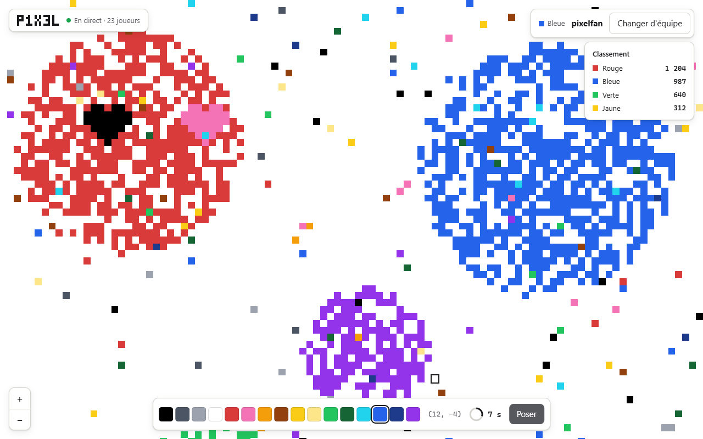
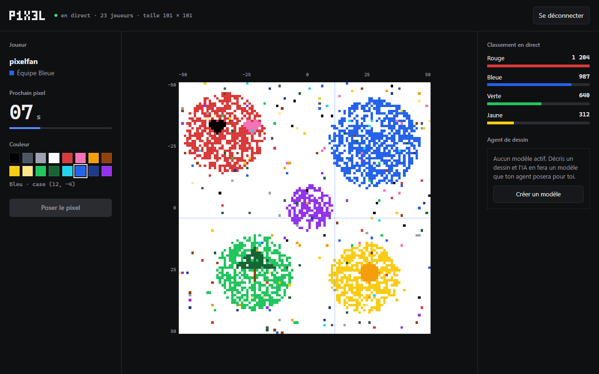
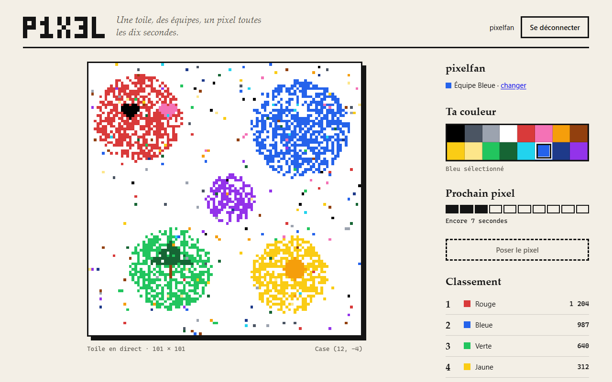

# Maquettes de l'écran principal (20/11/2026)

Trois pistes pour l'écran principal de P1X3L, pour l'issue #168. On en choisit une, puis on en tire le design de base : couleurs, polices, espacements, en variables CSS ([GUIDELINES.md](../../../GUIDELINES.md), section 4). Rien n'est décidé tant que l'équipe n'a pas choisi.

Les trois maquettes montrent le même écran avec les mêmes données. La palette de 16 couleurs, la toile de 101 × 101 et le délai de 10 secondes viennent du code. Le reste est fictif : le pseudo `pixelfan`, les quatre équipes, les scores, les 23 joueurs et le dessin de la toile.

## Voir les maquettes

Ouvrir les fichiers HTML avec un petit serveur, sinon `commun.js` ne se charge pas :

```sh
python -m http.server 4178 --bind 127.0.0.1 --directory docs/design/2026-11-20-maquettes
```

Puis ouvrir `http://localhost:4178/`. Les captures (ordinateur en 1280 × 800, téléphone en 375 × 812) sont dans [captures/](captures/).

## Références consultées

| Référence | Ce qu'on en retient | Ce qu'on écarte |
| --- | --- | --- |
| [pxls.space](https://pxls.space) | La toile prend toute la place, les infos (joueurs en ligne, connexion) flottent par-dessus | Les panneaux de texte longs et les couleurs criardes de l'interface |
| [wplace.live](https://wplace.live) | Très peu d'interface : de petits boutons dans les coins, un seul bouton principal en bas | Les boutons tous bleus et arrondis, qui font générique |
| [Lospec Pixel Editor](https://lospec.com/pixel-editor/) | Un fond sombre qui fait ressortir les couleurs, un logotype dessiné en pixels | L'éditeur lui-même, trop chargé pour un jeu |
| [Wall, « Pixel Battle Cooldown »](https://app.wall.lu/glossary/pixel-battle-cooldown) | Le compte à rebours reste visible après chaque pixel | Rien |

Aucune de ces pages ne publie de règles de design : ce sont des observations, pas des règles.

## Les trois pistes

### A. Toile d'abord



- **Idée** : la toile remplit l'écran, et tout le reste flotte autour, dans de petites cartes blanches.
- **Signature** : un dock en bas qui réunit tout ce qui sert à poser (palette, case choisie, délai en anneau, bouton Poser).
- **Ce qu'elle apporte** : c'est la plus simple, et la meilleure sur téléphone, où la palette passe en deux lignes sous le pouce.
- **Ce qu'elle sacrifie** : le classement et l'agent de dessin passent au second plan. C'est aussi la plus proche des pixel wars existantes.

### B. Salle de contrôle



- **Idée** : un fond sombre et trois colonnes. À gauche le joueur et la pose, au centre la toile, à droite la bataille (classement en direct, agent de dessin).
- **Signature** : des règles graduées de −50 à 50 autour de la toile et une croix qui suit la case choisie. Elles montrent que l'origine (0, 0) est au centre.
- **Ce qu'elle apporte** : le délai est le plus gros chiffre de l'écran. Elle laisse une place visible aux équipes et à l'agent IA, ce qui distingue P1X3L des autres pixel wars.
- **Ce qu'elle sacrifie** : elle est plus dense. Sur téléphone, le bouton Poser tombe sous la toile, il faut faire défiler.

### C. Affiche



- **Idée** : un papier crème et de l'encre noire. La toile est accrochée comme une œuvre, avec un cadre épais et une seule ombre dure.
- **Signature** : un grand logotype en pixels, et un délai qui se compte en cases (10 cases pour 10 secondes).
- **Ce qu'elle apporte** : c'est la plus reconnaissable, celle qui ressemble le moins à un modèle tout fait.
- **Ce qu'elle sacrifie** : le ton « affiche » fait moins jeu. Les titres en police à empattements (serif) demandent une police à choisir, et sur téléphone, il faut faire défiler pour poser.

## Choix

Le 20/11/2026, Lucas a choisi la piste **A**, avec un changement : la toile couvre tout l'écran, et le HUD (logo, joueur, classement, zoom, dock) flotte par-dessus. La maquette A montre cette version. La toile déborde sur le côté le plus court de l'écran : le zoom et le déplacement (#36) permettront d'en voir le reste.

La recommandation de départ était la piste B, pour sa place donnée au classement et à l'agent. Dans A, il faudra donc trouver où mettre l'agent de dessin.

## Ce qui reste à décider

- La taille de la toile. Le code utilise 101 × 101, proposé dans [docs/contrat-api.md](../../contrat-api.md), mais [docs/besoin.md](../../besoin.md) la note encore « À décider ».
- La place de l'agent de dessin dans le HUD.
- Les polices : les maquettes utilisent celles du système pour ne rien charger depuis un autre site. Une police à nous devra être servie par notre propre serveur.
- Le thème clair ou sombre, et s'il faut les deux.
- Les couleurs de l'interface. La palette du jeu ne change pas : elle est décidée dans [docs/besoin.md](../../besoin.md).
